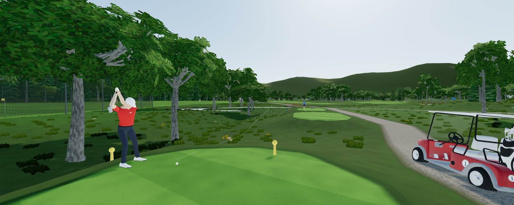
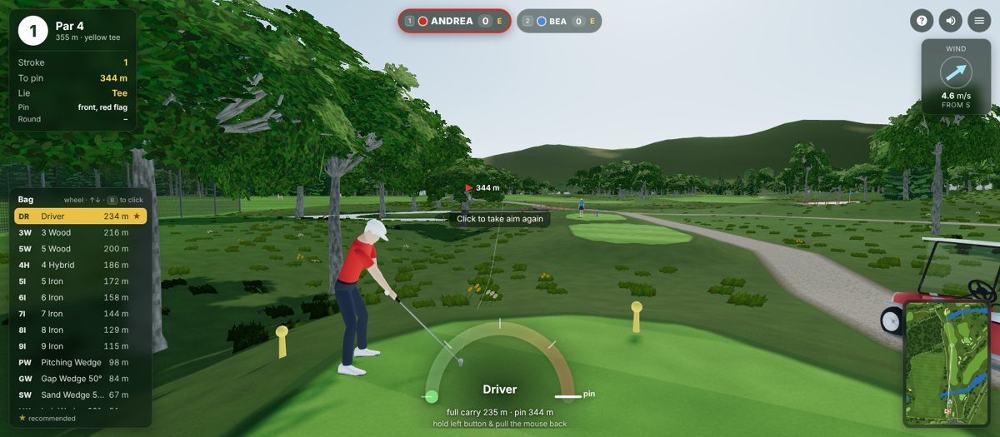
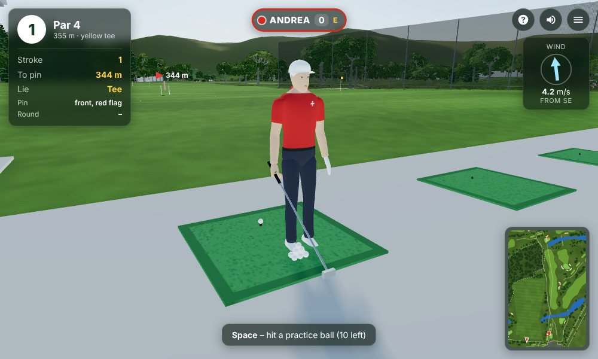
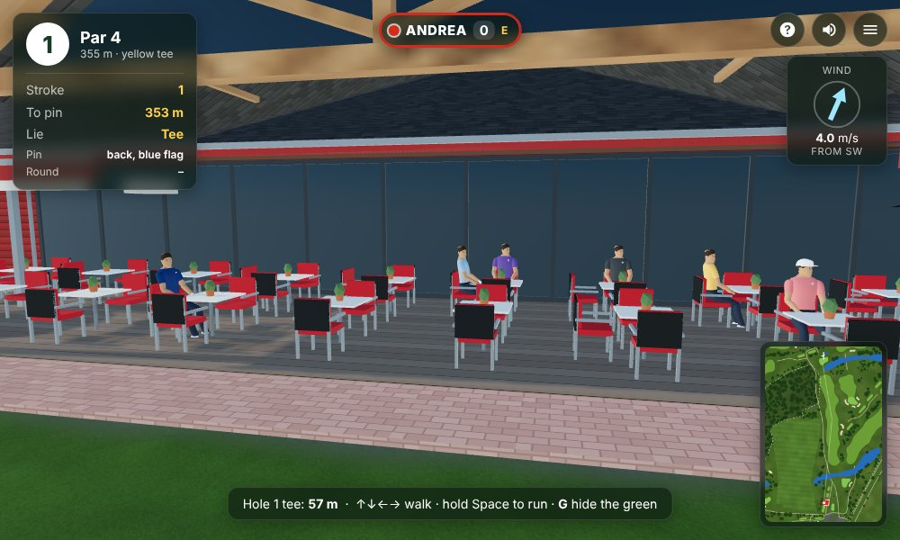

# SwissGolf



**A realistic golf game on real Swiss golf courses**, built from swisstopo terrain and lidar trees and OpenStreetMap
course data, running entirely in the browser (three.js, no build step, no server – it even works straight from
`file://`).

**▶ Play online: [afaisst.github.io/SwissGolf](https://afaisst.github.io/SwissGolf/)** – or open `index.html` locally.

## Courses

| Course | Holes | Par | Notes |
| --- | --- | --- | --- |
| **Golfclub Unterengstringen** (ZH) | 9 | 35 | club house with restaurant terrace, driving range, practice putting green |
| **Golf Les Bois** (Franches-Montagnes, JU) | 18 | 72 | high Jura spruce forest, a narrow-gauge railway crossing the course |

Terrain is swissALTI3D (0.5 m), every tree is a real tree from swissSURFACE3D, and greens, fairways, bunkers,
water, paths and buildings come from OpenStreetMap.

## Game play

- **1 – 4 players** (hot seat). Every player picks a name (printed on the back of the shirt), a colour, male or
  female, the tees (men: white / yellow, women: blue / red) and a cart number – two players can share a cart.
- **Realistic ball flight**: club speeds, launch, spin, drag and lift, wind and gusts, bounce and roll depending on
  the surface (green, fringe, fairway, rough, bunker, path …), trees that catch or deflect the ball, cups that lip out.
- **Rules of Golf**: penalty areas (Rule 17) with back-on-the-line, lateral and stroke-and-distance relief, out of
  bounds (Rule 18.2 / Model Local Rule E-5), honour on the tee, score card with statistics (fairways, putts,
  penalties, longest drive).
- **Golf carts**: drive to your ball, first or third person view, look around freely.
- **Green reading**: arrows flow down the slope of the green.
- **Ball cam**: a TV-style inset follows the ball while the main view stays with the golfer.
- **Weather**: sunny, fair, cloudy, overcast, fog and rain, with wind from any direction.
- **Practice** (Unterengstringen): get a basket of 10 balls at the machine on the **driving range** and fill a tee,
  or take a ball to the **practice putting green** with its nine flags – drop it anywhere and putt. Practice shots
  never count.
- **Save / load** a round in the browser.

<p>
  
  
</p>
<p></p>

## Controls

| | |
| --- | --- |
| **Walk** | `↑` `↓` walk · `←` `→` turn · hold `Space` + `↑` to run (watch your stamina) |
| **Address the ball** | `Space` right at your ball |
| **Aim** | move the mouse sideways or `←` `→` (`Shift` = fine) |
| **Club** | click it in the bag, mouse wheel or `↑` `↓` |
| **Swing** | hold the left mouse button and **pull the mouse back** for power, push forward for less, **release to hit** |
| **During the shot** | `Space` step away · hold `Space` while the ball rolls to fast-forward |
| **Interact** `E` | get on / off the cart, take balls at a ball machine, fill a range tee, drop / pick up a practice ball |
| **Cart** | `↑` `↓` `←` `→` drive · `Space` brake · `V` first / third person · drag the mouse to look around · `C` look ahead |
| **Green** | `G` read the green |
| **Game** | `M` big map · `R` restart the hole · `N` sound · `H` controls · `Esc` menu (save, settings, score card) |
| **Players** | `1` – `4` or click a player chip to switch · hover a chip for statistics |

Settings (in the menu, also during a round): sound, weather, wind, shadows, tall grass, and how far detailed trees
are drawn (150 m – 1 km).

## Project layout

```
index.html, css/, js/        the game (plain scripts, three.js r160 in lib/)
maps/courses.js              course registry
maps/<Course>/               course.js (holes, tees, par) + generated terrain.js, osm.js, trees.js
models/golfcart/             golf cart, converted to cart_model.js
tools/                       data builders (terrain, trees, cart) and model previews – not needed to play
```

Adding a course: put the swissALTI3D / swissSURFACE3D tiles in `maps/<Course>/topo/`, add `course.json` and
`course.js`, run `python3 tools/build_terrain.py maps/<Course>` and `python3 tools/build_trees.py maps/<Course>`,
fetch the OpenStreetMap data into `osm.js`, and register the course in `maps/courses.js`.

## Credits

- Terrain and trees © [swisstopo](https://www.swisstopo.admin.ch) (swissALTI3D, swissSURFACE3D)
- Map data © [OpenStreetMap](https://www.openstreetmap.org/copyright) contributors (ODbL)
- 3D engine: [three.js](https://threejs.org) (MIT)
- Golf cart: “Golf Cart (various)” by [Ian Gibb](https://sketchfab.com/slyguy),
  [CC BY 4.0](http://creativecommons.org/licenses/by/4.0/) (see `models/golfcart/golf_cart_various/license.txt`)
- Golfer bodies adapted from [“slop-newyork”](https://github.com/mrdoob/slop-newyork/) by Mr.doob (MIT)
